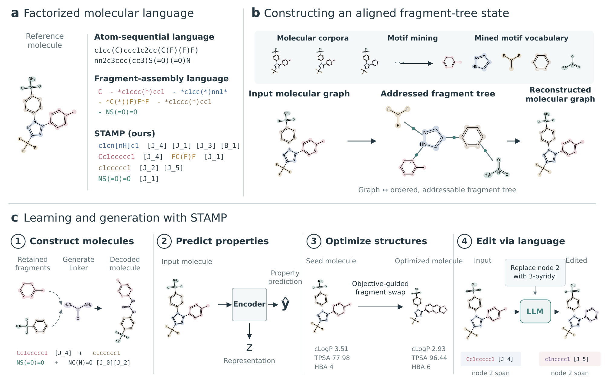

# STAMP

**Sequential Tree Attachment-based Motif-Preserving representation**: a
topology-aware molecular language for fragment-level learning and editing.

[Paper](https://arxiv.org/abs/2610.18438) ·
[Models](https://huggingface.co/bi0s/STAMP_V1) ·
[Data](https://huggingface.co/datasets/bi0s/STAMP_V1-data)



STAMP separates motif identity, attachment sites and fragment-tree topology.
The same representation supports molecular learning, construction and editing.
[Vector figure](assets/method.pdf).

## Results

Selected generation results from the paper, reported as mean ± sample standard
deviation across five seeds. Validity and quality are percentages; quality counts
unique valid molecules passing QED ≥ 0.6 and SA ≤ 4 per generation request,
and additionally requires fragment preservation for constrained tasks.

| Task | Validity | Quality | Diversity |
| --- | ---: | ---: | ---: |
| De novo | 99.71 ± 0.15 | 87.99 ± 1.08 | 0.861 ± 0.001 |
| Linker design | 98.20 ± 0.35 | 36.56 ± 0.22 | 0.565 ± 0.003 |
| Motif extension | 98.38 ± 0.38 | 55.12 ± 0.80 | 0.609 ± 0.002 |
| Scaffold decoration | 98.84 ± 0.24 | 30.14 ± 0.89 | 0.521 ± 0.003 |
| Superstructure generation | 98.97 ± 0.21 | 58.00 ± 1.53 | 0.564 ± 0.002 |

Download the archived [de novo results](assets/results/denovo.json),
[fragment-task summary](assets/results/fragment_generation.tsv) and
[per-seed results](assets/results/fragment_generation_per_seed.tsv).

## Requirements and installation

The CPU demo was tested on RHEL 9.8 (x86-64), Python 3.12.12,
RDKit 2023.09.6 and NumPy 1.26.4. It requires no GPU.

```bash
git clone https://github.com/YuX-Ren/STAMP_V1.git
cd STAMP_V1
python3.12 -m venv .venv-demo
source .venv-demo/bin/activate
python -m pip install -r envs/requirements-demo.txt
```

Estimated installation time on a desktop with Python installed: 2–10 minutes.
For GPU training, the environment recipe specifies Python 3.12, RDKit
2025.09.4, PyTorch 2.6.0 and CUDA 12.4:

```bash
conda env create -f envs/stamp-train-rdkit-2025.09.4.yml
conda activate stamp-train-rdkit-2025_09_4
```

Keep the RDKit version matched to the vocabulary and checkpoint when
reproducing token sequences. Study training used NVIDIA H200 GPUs.

## Demo

Run the bundled ten-molecule dataset:

```bash
python scripts/core/run_codec_demo.py
diff -u examples/codec/expected_roundtrips.tsv results/demo/roundtrips.tsv
```

Expected output:

```text
SUMMARY passed=10 total=10 failed=0
```

Fields are tab-separated. The output TSV contains input SMILES, STAMP,
recovered SMILES and status. `diff` produces no output on an exact match.
Measured runtime: 0.65 seconds on an Intel Xeon Gold 6438N; allow 1–5 seconds
on a desktop. Use a new `--output` path to repeat the demo.

## Usage

Run from the checkout root:

```bash
python scripts/smiles_to_stamp.py "CCO"
python scripts/validate_roundtrip.py "CCO"
python scripts/core/run_codec_demo.py --input my_molecules.txt --output results/my_roundtrips.tsv
python scripts/build_vocab.py my_molecules.csv --smiles-column smiles --output-dir results/vocab/my_vocab
python scripts/experiments_cli.py --help
```

Text input uses one SMILES per line; CSV input uses a `smiles` column.

## Checkpoints

Pretrained weights and companion vocabularies/configurations are available on
[Hugging Face](https://huggingface.co/bi0s/STAMP_V1).

| Task | Checkpoint directory |
| --- | --- |
| De novo generation | `ao_generation` |
| Four-layer comparison, eight representations | `controlled_*` (see model card) |
| Linker, motif extension, superstructure | `fragment_infill` |
| Scaffold decoration | `scaffold_decoration` |
| Property learning | `encoder_mlm`, `encoder_mtr` |
| Molecule–text translation | `molt5_mol2text_valid_best`, `molt5_text2mol_valid_best` |

Download the generation models:

```bash
python -m pip install huggingface_hub
hf download bi0s/STAMP_V1 --include 'ao_generation/*' --local-dir checkpoints
hf download bi0s/STAMP_V1 --include 'fragment_infill/*' --local-dir checkpoints
hf download bi0s/STAMP_V1 --include 'scaffold_decoration/*' --local-dir checkpoints
```

Keep each model's companion files in the same directory. The model repository
includes a SHA-256 manifest. [MODEL_CARD.md](MODEL_CARD.md) lists all versions.

## Run paper tasks

Activate the GPU training environment above. The following entry point calls
the existing evaluators with the paper's sampling settings. It defaults to
CUDA and seed 20260525; add `--device cpu --smoke` for a short, two-sample
installation check. Smoke runs do not reproduce the benchmark results.

### De novo generation

```bash
python scripts/benchmark/run_paper_generation.py denovo \
  --model-root checkpoints --output-dir results/denovo
```

This requests 1,024 samples at temperature 0.7 and top-p 0.95. Outputs include
`denovo_eval.json` and `denovo_samples.tsv` (unique valid molecules with QED
and SA scores).

### Fragment-constrained generation

The four prepared query files are included in `examples/fragments/`, derived
from the [GenMol fragment benchmark](https://github.com/NVIDIA-BioNeMo/genmol/blob/main/data/fragments.csv)
using STAMP's preparation scripts. Linker, motif and scaffold tasks contain ten
queries each; superstructure contains 39 attachment-site prompts aggregated
over ten queries. These are evaluation inputs, not training data.

```bash
python scripts/benchmark/run_paper_generation.py linker --model-root checkpoints --output-dir results/linker
python scripts/benchmark/run_paper_generation.py motif --model-root checkpoints --output-dir results/motif
python scripts/benchmark/run_paper_generation.py scaffold --model-root checkpoints --output-dir results/scaffold
python scripts/benchmark/run_paper_generation.py superstructure --model-root checkpoints --output-dir results/superstructure
```

Each task writes a metrics JSON and a predictions TSV. To run the five-seed
protocol for a task:

```bash
for seed in 20260525 20260526 20260527 20260528 20260529; do
  python scripts/benchmark/run_paper_generation.py linker --model-root checkpoints \
    --seed "$seed" --output-dir "results/linker_seed${seed}"
done
```

Use `--dry-run` to inspect the full native command, or `--help` for options.

### Molecule–text translation

For ChEBI-20 text-to-molecule evaluation, supply the prepared official test
parquet (`text2mol_source`, `text2mol_target`, `smiles` columns):

```bash
python -m pip install -r envs/requirements-translation.txt
hf download bi0s/STAMP_V1 --include 'molt5_text2mol_valid_best/*' --local-dir checkpoints
hf download bi0s/STAMP_V1-data main/data/chebi20/finetune_zinc_curated30k/test.parquet \
  --repo-type dataset --local-dir datasets
python scripts/benchmark/eval_molt5_chebi20.py \
  --ckpt-dir checkpoints/molt5_text2mol_valid_best \
  --stamp-vocab checkpoints/molt5_text2mol_valid_best/motif_vocab.txt \
  --test-parquet datasets/main/data/chebi20/finetune_zinc_curated30k/test.parquet --direction text2mol \
  --num-beams 5 --max-new-tokens 256 --batch-size 32 --device cuda \
  --output-dir results/text2mol
```

Outputs include predictions and metrics. Training corpora, prepared ChEBI-20
splits, property datasets and checksums are available in the public
[data repository](https://huggingface.co/datasets/bi0s/STAMP_V1-data).
Its [file index](https://huggingface.co/datasets/bi0s/STAMP_V1-data/blob/main/main/data/manifests/release_files.tsv)
lists the actual downloadable files.
The [LLM task snapshots](https://huggingface.co/datasets/bi0s/STAMP_V1-data/tree/main/main/data/llm_tasks)
include six S2 tasks (500 examples each), 120 shared-label transfer examples
and 100 change-identification pairs, with their original experiment manifests.

## Code layout

| Directory | Contents |
| --- | --- |
| `stamp/core/` | Encoding and reconstruction |
| `stamp/vocab/` | Motif vocabulary construction |
| `stamp/benchmark/` | Models, tasks and evaluation |
| `scripts/` | Command-line entry points and training launchers |
| `envs/` | Environment specifications |
| `examples/codec/` | Demo data and expected output |
| `examples/fragments/` | Fragment-constrained benchmark queries |
| `assets/` | Paper method figure and selected result tables |

Training and evaluation commands expose `--help`. HPC launchers require local
data paths and scheduler settings to be adapted to the target system.

## License

[MIT](LICENSE). Upstream models and datasets retain their respective terms.
